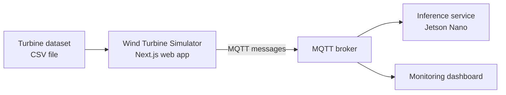

<div align="center">

# 🌬️ Wind Turbine Simulator

**A web app that replays wind turbine sensor data over MQTT, so a predictive maintenance system can be tested without a real turbine.**


</div>

---

## 📖 About

This simulator was built for my final-year engineering project at **CDER** (Renewable Energy Development Center): a deep learning system for **predictive maintenance of wind turbines** that runs on a **Jetson Nano**.

Testing such a system needs a steady stream of turbine measurements, but a real turbine isn't always available. The simulator solves this: you load a dataset of turbine sensor readings, and it publishes the readings over **MQTT**, as a real turbine's data logger would. Any MQTT subscriber, such as an embedded inference service or a dashboard, can then consume them live.

## 🔄 How it fits together



## ✨ Features

- **Drag-and-drop dataset upload**: drop a CSV file into the browser ([react-dropzone](https://react-dropzone.js.org/)).
- **In-browser CSV parsing** with [PapaParse](https://www.papaparse.com/), so no backend is needed.
- **MQTT publishing** of the readings to a broker with [MQTT.js](https://github.com/mqttjs/MQTT.js).
- **Modern web stack**: Next.js 15 (App Router), React 19, TypeScript and Tailwind CSS.

## 🧰 Tech stack

| Layer | Technology |
|---|---|
| Framework | Next.js 15 (App Router, Turbopack in dev) |
| UI | React 19, Tailwind CSS 3.4 |
| Language | TypeScript 5 |
| Messaging | MQTT.js 5 |
| Data handling | PapaParse 5, react-dropzone 14 |
| Linting | ESLint 9 with `eslint-config-next` |

## 🚀 Getting started

**Requirements:** Node.js 18.18 or newer, and an MQTT broker (for example [Eclipse Mosquitto](https://mosquitto.org/)) that the app can reach.

```bash
# 1. Clone the repository
git clone https://github.com/HadjerL/wind-turbine-simulator.git
cd wind-turbine-simulator

# 2. Install dependencies
npm install

# 3. Start the development server
npm run dev
```

Open <http://localhost:3000> in your browser.

### Production build

```bash
npm run build
npm start
```

## 🕹️ Usage

1. Start your MQTT broker.
2. Open the simulator in your browser.
3. Drop a turbine data CSV file into the upload area.
4. Start the simulation: the readings are published to the broker, and your subscriber receives them.

<!-- TODO: add a screenshot, e.g.  -->
<!-- TODO: document the expected CSV columns, the MQTT broker URL setting and the topic names -->

## 🗂️ Project structure

```
wind-turbine-simulator/
├── public/          # Static assets
├── src/app/         # Next.js App Router pages and components
├── next.config.ts
├── tailwind.config.ts
└── package.json
```

## 🔗 Related project

The predictive maintenance system this simulator was built to test (CNN / LSTM models for fault classification and power forecasting, deployed on a Jetson Nano) is described in my [GitHub profile](https://github.com/HadjerL).

## 👩‍💻 Author

**Hadjer Laissaoui**, [LinkedIn](https://www.linkedin.com/in/hadjer-laissaoui-13a420255/) · [Medium](https://medium.com/@hadjerlais77)
